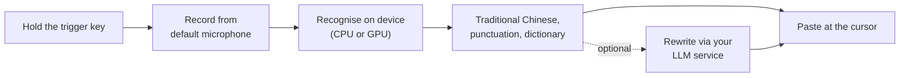

<div align="center">

# talk-type

**Hold a key, speak, release: your words appear at the cursor.**

Offline push-to-talk dictation for Windows, tuned for Traditional Chinese mixed with English.

[](https://github.com/changemyminds/talk-type/releases/latest)
[](https://github.com/changemyminds/talk-type/releases)
[-0078D6)](#requirements)
[](#privacy)

**English** · [繁體中文](README.zh-TW.md)

[Download](https://github.com/changemyminds/talk-type/releases/latest) ·
[Quick start](#quick-start) ·
[Models](#speech-recognition-models) ·
[FAQ](#troubleshooting) ·
[Report a bug](https://github.com/changemyminds/talk-type/issues)

</div>

> [!NOTE]
> This repository hosts **release builds and documentation only**; the source code is maintained privately.
> The user interface (tray menu and on-screen messages) is in Traditional Chinese. Menu names below are given in Chinese with an English translation.

## Contents

- [Features](#features)
- [How it works](#how-it-works)
- [Requirements](#requirements)
- [Quick start](#quick-start)
- [Usage](#usage)
- [Speech recognition models](#speech-recognition-models)
- [Configuration](#configuration)
- [Personal dictionary](#personal-dictionary)
- [Optional rewriting](#optional-rewriting)
- [Updating](#updating)
- [Privacy](#privacy)
- [Troubleshooting](#troubleshooting)
- [Uninstall](#uninstall)
- [Reporting issues](#reporting-issues)
- [Acknowledgements](#acknowledgements)
- [Disclaimer](#disclaimer)

## Features

| | |
|---|---|
| **Works in any app** | Hold Right Ctrl (configurable), speak, release. The text is pasted wherever the cursor is. A toggle mode covers longer passages. |
| **On-device recognition** | Audio never leaves your computer. Switch between six open models from the tray menu: Qwen3-ASR, Whisper, Breeze-ASR-25, SenseVoice, X-ASR and Parakeet. |
| **Written for Taiwan** | Simplified-to-Traditional conversion, Taiwan wording, punctuation clean-up and spacing between Chinese and English. |
| **Personal dictionary** | Teach it the names and jargon the recognizer keeps getting wrong. |
| **Safe pasting** | Never types into password fields, restores your clipboard (including images and files) and keeps dictated text out of the Win+V history. |
| **Optional rewriting** | Polish each sentence, or turn it into bullet points, through an OpenAI-compatible service you choose: a local Ollama or LM Studio, or a cloud provider. Off by default. |
| **Signed automatic updates** | New releases are verified with SHA-256 and an Ed25519 signature before they are installed. |

## How it works



## Requirements

- Windows 10 or 11, 64-bit
- About 1–2 GB of free memory while recognising
- Disk space for the models you use: 140 MB to 1.1 GB each (see [models](#speech-recognition-models))
- A GPU is optional; on CPU the default model takes about 1–1.5 s per sentence
- An internet connection for the first model download

## Quick start

1. Download the latest `talk-type-vX.Y.Z.zip` from [Releases](https://github.com/changemyminds/talk-type/releases/latest).
2. **Unblock the zip before extracting it.** Right-click the zip → *Properties* → tick *Unblock* → *OK*, or in PowerShell:

   ```powershell
   Unblock-File "$HOME\Downloads\talk-type-vX.Y.Z.zip"
   ```

   The builds are not code-signed. Without this step, Windows SmartScreen warns on every launch. If it still appears, choose *More info* → *Run anyway*.
3. Extract to a permanent folder you can write to, for example `D:\Apps\talk_type\` (not `C:\Program Files`, or automatic updates cannot replace the program).
4. Run `talk_type.exe`. On first launch it:
   - creates its settings and a starter dictionary;
   - adds desktop and Start-menu shortcuts and turns on start at sign-in (you can turn this off from the tray);
   - downloads the default model, Qwen3-ASR (about 880 MB), showing progress in a small overlay.
5. When the talk-type icon appears in the system tray, you are ready to dictate.

<details>
<summary>Verifying a download by hand</summary>

Each release lists the SHA-256 digest of its zip. Compare it with:

```powershell
Get-FileHash .\talk-type-vX.Y.Z.zip -Algorithm SHA256
```

Automatic updates also check the `.zip.sig` signature that is attached to every release.

</details>

## Usage

| Action | How |
|---|---|
| Dictate (hold mode, default) | Hold the trigger key. When the overlay shows **● 錄音中** (*recording*), speak, then release. |
| Dictate (toggle mode) | Tap the trigger key once to start and again to stop. Good for longer passages. |
| Cancel | Press **Esc** while recording. |
| Copy the last result again | Tray → **複製上一句** (*copy last sentence*). |

- The key has to be held for about 0.25 s before recording starts. This keeps shortcuts such as Ctrl+C working as usual.
- One recording can be up to 2 minutes long; after that it stops and is recognised automatically.
- talk-type follows the Windows default input device, so a newly selected microphone is used from the next sentence.

### When text is not pasted automatically

In these cases the text is left on the clipboard, the overlay explains why, and you can paste it with Ctrl+V:

- the focus is not in a text field, or it is in a password field;
- you switched windows before recognition finished;
- the target app runs as administrator;
- the trigger key, Shift or Alt is still held down.

### Tray menu

Right-click the tray icon:

| Item | What it does |
|---|---|
| 辨識模型 ▸ (*recognition model*) | Switch models. The current one is ticked; models not yet downloaded show their size. |
| 整理方式 ▸ (*rewriting*) | Off (default), polish (潤飾) or bullet-point summary (重點摘要). See [optional rewriting](#optional-rewriting). |
| 設定整理服務的 key… (*set service key*) | Enter or delete the API key of your rewriting service. |
| 開啟設定檔 (*open settings*) | Opens `config.toml` in your default editor. |
| 重新載入 (*reload*) | Rereads settings and dictionary; applies from the next sentence. |
| 複製上一句 (*copy last sentence*) | Puts the last pasted text on the clipboard. |
| 更新到 vX.Y.Z (*update to vX.Y.Z*) | Shown only when a new version is available. |
| 重新下載模型 (*re-download model*) | Use when a model is damaged or its download failed. |
| 建立捷徑 (*create shortcuts*) | Recreates the desktop and Start-menu shortcuts. |
| 開機自動啟動 (*start at sign-in*) | Turns start at sign-in on or off. |
| 檢查更新 (*check for updates*) | Checks for a new version now. |
| 結束 (*exit*) | Quits talk-type. |

## Speech recognition models

Models are not bundled. Each one is downloaded from its publisher the first time you select it and checked against a SHA-256 hash. The next sentence uses the new model, and your choice is saved to `config.toml`.

| Model | Download | Character error rate | Time per sentence | Best for |
|---|---:|---:|---|---|
| **Qwen3-ASR 0.6B** (default) | 879 MB | 8.5% | 1–1.5 s | Speed |
| Breeze-ASR-25 | 1.08 GB | **5.7%** | 7–8 s (GPU) | Accuracy, heavy Chinese–English mixing |
| Whisper large-v3-turbo | 574 MB | 6.8% | 3–5 s (GPU) | Balance of accuracy and speed |
| SenseVoice-Small | 166 MB | 11.7% | 0.2 s | Fastest, but no punctuation |
| X-ASR zh-en | 136 MB | not yet measured | about 1/6 of Qwen3 | Fast, with punctuation |
| Parakeet TDT 0.6B v2 | 482 MB | not yet measured | about 1/3 of Qwen3 | **English only** |

<sub>Measured on a laptop with an Intel Core i5-13500H and integrated graphics, using 30 sentences of mixed Traditional Chinese and English. X-ASR and Parakeet were only timed against Qwen3 on another machine.</sub>

- X-ASR spells out English abbreviations letter by letter ("PR" becomes "P R"). Add an alias in the dictionary to fix the ones you use often.
- X-ASR and Parakeet ignore dictionary hints and rely on alias replacement only.
- Parakeet understands English only. Chinese comes out as pinyin or nonsense.
- Models you switch away from stay on disk; all six take about 5–6 GB. To free space, delete unused ones from `%LOCALAPPDATA%\talk_type\models`.

## Configuration

Settings live in `%APPDATA%\talk_type\config.toml`. Edit and save the file, then choose **重新載入** (*reload*) in the tray. If the file contains a mistake, talk-type keeps the previous settings, shows a message and does not overwrite your file.

```toml
[trigger]
key = "RightCtrl"   # trigger key
mode = "hold"       # "hold" or "toggle"

[audio]
warm_seconds = 60   # keep the microphone open this long after a sentence, so the next one isn't clipped; 0 = close at once
beep = false        # beep when recording starts and stops

[recognition]
device = "auto"     # "auto", "cpu" or "gpu"
# model = "qwen3-asr-0.6b"   # easier to change from the tray menu

[paste]
restore_delay_ms = 250   # wait before restoring the clipboard; raise it if an app pastes stale content
```

### Choosing a trigger key

Supported keys: `RightCtrl`, `LeftCtrl`, `RightAlt`, `LeftAlt`, `RightShift`, `LeftShift`, `RightWin`, `LeftWin`, `Menu`, `CapsLock`, `ScrollLock`, `Pause`, `Insert` and `F1`–`F24` (case-insensitive).

- Pick a key you rarely press on its own: Right Ctrl (default), Right Alt (AltGr also works) or a spare function key.
- Avoid **CapsLock**: talk-type does not swallow the key, so every use toggles caps lock.
- Avoid the **Win** keys: pressed alone they open the Start menu.

## Personal dictionary

`%APPDATA%\talk_type\dictionary.toml` holds the correct spelling of each term and the ways it tends to be misheard:

```toml
[[term]]
correct = "Claude Code"
aliases = ["CloudCo", "Clod Cod"]

[[term]]
correct = "worktree"     # no aliases: used only as a recognition hint
```

- Correct spellings are also passed to the recognizer as hints. **Add new terms at the end of the file**, because later entries take priority.
- Aliases are always replaced, so only list misspellings that never occur in normal text. Don't use ordinary words, names or abbreviations as aliases.
- English aliases match whole words, ignoring case. Aliases that contain Chinese match literally; write them in Traditional Chinese.
- talk-type creates a starter dictionary on first launch and never overwrites it afterwards.

## Optional rewriting

Rewriting sends each recognised sentence to a language model before pasting:

- **潤飾 (polish)** removes filler words such as 「呃、那個、就是」, adds punctuation and turns speech into fluent sentences. It keeps the meaning, adds nothing and leaves English as spoken.
- **重點摘要 (summary)** turns a long passage into bullet points, one per line.
- **關 (off)**, the default, makes no connection at all.

Any service that speaks the OpenAI chat-completions format works, including an LLM on your own computer.

1. Choose polish or summary once from tray → **整理方式 ▸**. A `[polish]` section with three examples is added to the end of `config.toml`.
2. Open the settings, fill in `base_url` (up to `/v1`) and `model`, save, and choose **重新載入** (*reload*):

   ```toml
   [polish]
   mode = "polish"
   base_url = "http://localhost:11434/v1"   # Ollama; LM Studio: http://localhost:1234/v1; OpenAI: https://api.openai.com/v1
   model = "qwen2.5:7b"
   timeout_secs = 15
   ```

3. If the service needs an API key (cloud services usually do), set it from tray → **設定整理服務的 key…**. The key is stored in Windows Credential Manager as `talk_type/polish`, never in the settings file.

Good to know:

- Only the recognised text is sent: no audio, history or dictionary.
- A cloud service can read what you dictate. Use a local Ollama or LM Studio if that matters to you.
- Plain `http://` is allowed only for localhost, private-network and Tailscale addresses. Services on the internet must use `https://`.
- If rewriting fails or takes longer than `timeout_secs`, the unmodified text is pasted and the overlay shows why. Nothing you said is lost, and Ctrl+Z undoes a rewrite you don't like.

## Updating

Starting with **v0.12.0**, talk-type checks this repository for new releases 30 seconds after start-up and then once a day, or right away from tray → **檢查更新**.

1. When a new version is out, the overlay mentions it once and the tray menu offers **更新到 vX.Y.Z** (*update*) plus a link to the release notes.
2. The download is checked against its size, SHA-256 hash and the Ed25519 signature from the release pipeline. Only then does talk-type replace itself and restart. If you are in the middle of a sentence, it waits until you finish.
3. Settings, dictionary, models, history, shortcuts and start at sign-in are kept.

If the new version misbehaves, the previous one is kept as `talk_type.old.exe` in the same folder. Quit talk-type, delete `talk_type.exe` and rename `talk_type.old.exe` to `talk_type.exe`.

<details>
<summary>Updating by hand (or from v0.11.0 and earlier)</summary>

1. **Quit the running copy first** from tray → **結束**. Only one instance can run; a second one exits immediately.
2. Repeat [Quick start](#quick-start) steps 1–4 with the new zip. You can extract over the old folder or into a new one.

Settings, dictionary, models and history are kept, and existing shortcuts and start at sign-in are pointed at the new copy.

</details>

## Privacy

Recognition runs entirely on your computer. talk-type connects to the internet only to:

- download recognition models from their official sources (Hugging Face and the sherpa-onnx GitHub releases);
- check this repository for updates and download them, without sending any of your data;
- send text to your rewriting service, and only if you turned rewriting on.

| Data | Location |
|---|---|
| Settings and dictionary | `%APPDATA%\talk_type\` |
| Models | `%LOCALAPPDATA%\talk_type\models\` |
| History (last 50 sentences) | `%LOCALAPPDATA%\talk_type\history.toml` |
| Logs (lengths, timings and results only, **never what you said**; kept for 7 days) | `%LOCALAPPDATA%\talk_type\logs\` |

All of this stays on your computer.

## Troubleshooting

<details>
<summary><b>Windows says "Windows protected your PC" on every launch</b></summary>

The zip was not unblocked before extracting. Unblock it as in [Quick start](#quick-start) step 2 and extract again, or right-click `talk_type.exe` → *Properties* → tick *Unblock*.
</details>

<details>
<summary><b>Nothing happens when I press the trigger key</b></summary>

Check that the tray icon is there and that the model has finished downloading. Until it has, the overlay shows 「模型還沒準備好」 (*model not ready*).
</details>

<details>
<summary><b>"沒有錄到聲音" (no audio recorded)</b></summary>

The microphone is muted, only background noise was picked up, or Windows is blocking microphone access. Go to *Settings → Privacy & security → Microphone* and turn on *Let desktop apps access your microphone*.
</details>

<details>
<summary><b>"太短了" (too short)</b></summary>

Less than 0.3 s of audio was recorded. In hold mode, the first 0.25 s only confirms that you are pressing the trigger key on its own. Wait for **● 錄音中** before you start speaking.
</details>

<details>
<summary><b>Recognition is slow</b></summary>

The default model takes about 1–1.5 s per sentence on CPU. Switch to X-ASR zh-en (much faster, with punctuation) or SenseVoice-Small (also fast, but no punctuation and more errors) from tray → **辨識模型 ▸**.
</details>

<details>
<summary><b>English words in mixed sentences come out wrong</b></summary>

Add the words to the [dictionary](#personal-dictionary) first; that usually helps more than switching models. If it doesn't, try Breeze-ASR-25, the most accurate model but also the slowest. If you speak only English, switch to Parakeet TDT 0.6B v2.
</details>

<details>
<summary><b>Rewriting fails ("…，已貼上未整理的文字")</b></summary>

The first half of the message gives the reason:

| Message | Meaning |
|---|---|
| 還沒設定整理服務 | No service configured yet. Fill in `base_url` and `model`. |
| 連不上整理服務 | Cannot connect. Check that Ollama or LM Studio is running and the port is right. |
| 整理服務拒絕了請求 | The API key is wrong or expired. Set it again from the tray. |
| 整理服務要用 https | Internet services must use `https://`. |
| 整理服務的網址有誤 | Invalid URL. It must start with `http://` or `https://` and contain no credentials. |
| 整理服務回傳錯誤 | The service returned an error or empty text. Check the `model` name. |
| 整理逾時 | Timed out. Use a smaller model or raise `timeout_secs`. |
</details>

<details>
<summary><b>The desktop shortcut is missing</b></summary>

Choose **建立捷徑** (*create shortcuts*) from the tray menu.
</details>

## Uninstall

1. Turn off **開機自動啟動** (*start at sign-in*) in the tray, then choose **結束** (*exit*).
2. Delete the folder you extracted, plus `%APPDATA%\talk_type` and `%LOCALAPPDATA%\talk_type`.
3. Delete the talk-type shortcuts from the desktop and Start menu.

## Reporting issues

Found a bug or have a suggestion? [Open an issue](https://github.com/changemyminds/talk-type/issues) and include:

- the talk-type version (the first line of the tray menu) and your Windows version;
- the model you were using and the message shown in the overlay;
- the relevant lines from `%LOCALAPPDATA%\talk_type\logs\`. Logs never contain what you said.

Please don't attach recordings or your history file if they contain anything private.

## Acknowledgements

talk-type builds on these open-source projects and models:

- [whisper.cpp](https://github.com/ggml-org/whisper.cpp) and [sherpa-onnx](https://github.com/k2-fsa/sherpa-onnx), the recognition engines
- [Qwen3-ASR](https://github.com/QwenLM/Qwen3-ASR) (Apache-2.0), [Breeze-ASR-25](https://huggingface.co/MediaTek-Research/Breeze-ASR-25) (Apache-2.0), [Whisper](https://github.com/openai/whisper) (MIT), [SenseVoice](https://github.com/FunAudioLLM/SenseVoice) (FunASR Model License), X-ASR (Apache-2.0) and [Parakeet TDT](https://huggingface.co/nvidia/parakeet-tdt-0.6b-v2) (CC-BY-4.0)

Each model is downloaded from its publisher and stays under its own licence.

## Disclaimer

talk-type is a personal project, provided as is, without warranty of any kind.
