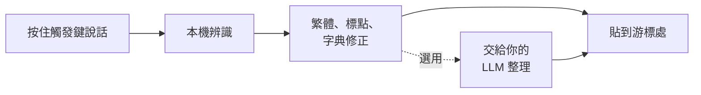

<div align="center">

# talk-type

**按住說話，放開就打字。**

Windows 上的離線語音輸入工具，專為繁體中文與中英夾雜調校。

[](https://github.com/changemyminds/talk-type/releases/latest)
[](https://github.com/changemyminds/talk-type/releases)
[-0078D6)](#系統需求)
[](#隱私)

[English](README.md) · **繁體中文**

[下載](https://github.com/changemyminds/talk-type/releases/latest) ·
[快速開始](#快速開始) ·
[辨識模型](#辨識模型) ·
[常見問題](#常見問題) ·
[回報問題](https://github.com/changemyminds/talk-type/issues)

</div>

> [!NOTE]
> 這個 repo **只放發行版與說明文件**，原始碼在私有 repo 維護。

## 目錄

- [功能](#功能)
- [運作方式](#運作方式)
- [系統需求](#系統需求)
- [快速開始](#快速開始)
- [使用方式](#使用方式)
- [辨識模型](#辨識模型)
- [設定](#設定)
- [個人字典](#個人字典)
- [整理方式（選用）](#整理方式選用)
- [更新](#更新)
- [隱私](#隱私)
- [常見問題](#常見問題)
- [移除](#移除)
- [回報問題](#回報問題)
- [致謝](#致謝)
- [免責聲明](#免責聲明)

## 功能

| 功能 | 說明 |
|---|---|
| **任何程式都能用** | 按住右 Ctrl（可改）說話，放開後文字貼到游標處；長段落可用切換模式。 |
| **本機辨識** | 錄音不會離開你的電腦。可從系統匣切換六個開放模型：Qwen3-ASR、Whisper、Breeze-ASR-25、SenseVoice、X-ASR、Parakeet。 |
| **台灣用語** | 簡轉繁、兩岸用語修正、標點整理、中英文之間自動加空白。 |
| **個人字典** | 常被聽錯的人名與專有名詞，加進字典就會自動修正。 |
| **安全貼上** | 不會輸入到密碼欄位；貼上後還原剪貼簿（含圖片與檔案），說的話也不會進 Win+V 歷史。 |
| **整理方式（選用）** | 把每句交給你指定的 OpenAI 相容服務潤飾或整理成重點，本機 Ollama、LM Studio 或雲端服務都可以；預設關閉。 |
| **有簽章的自動更新** | 新版先驗證 SHA-256 與 Ed25519 簽章，通過才安裝。 |

## 運作方式



## 系統需求

- Windows 10 或 11（64 位元）
- 辨識時約需 1–2 GB 可用記憶體
- 要用的模型所需的磁碟空間，每個 140 MB–1.1 GB（見[辨識模型](#辨識模型)）
- 不一定要有 GPU：預設模型用 CPU 一句約 1–1.5 秒
- 第一次下載模型時需要網路

## 快速開始

1. 到 [Releases](https://github.com/changemyminds/talk-type/releases/latest) 下載最新的 `talk-type-vX.Y.Z.zip`。
2. **解壓縮前先解除封鎖**：在 zip 上按右鍵 →「內容」→ 勾「解除封鎖」→「確定」，或在 PowerShell 執行：

   ```powershell
   Unblock-File "$HOME\Downloads\talk-type-vX.Y.Z.zip"
   ```

   程式沒有程式碼簽章，不解除的話每次啟動 SmartScreen 都會警告。如果還是跳出「Windows 已保護您的電腦」，點「其他資訊」→「仍要執行」。
3. 解壓縮到自己有寫入權限的固定資料夾，例如 `D:\Apps\talk_type\`。不要放 `C:\Program Files`，否則無法自動更新。
4. 執行 `talk_type.exe`。第一次啟動時會：
   - 建立設定檔與起始字典；
   - 在桌面與開始功能表放捷徑，並開啟開機自動啟動（可從系統匣取消）；
   - 下載預設模型 Qwen3-ASR（約 880 MB），浮動窗顯示進度。
5. 系統匣出現 talk-type 的圖示就可以開始用了。

<details>
<summary>自己驗證下載的檔案</summary>

每個 Release 都列出 zip 的 SHA-256。用下面的指令比對：

```powershell
Get-FileHash .\talk-type-vX.Y.Z.zip -Algorithm SHA256
```

自動更新另外會驗證每個 Release 附的 `.zip.sig` 簽章。

</details>

## 使用方式

| 動作 | 做法 |
|---|---|
| 說話（按住模式，預設） | 按住觸發鍵，等浮動窗出現 **● 錄音中** 後說話，說完放開。 |
| 說話（切換模式） | 單獨按一下觸發鍵開始，說完再按一下結束。適合長的一段話。 |
| 取消這一句 | 錄音中按 **Esc**。 |
| 再拿一次上一句 | 系統匣 →「複製上一句」。 |

- 觸發鍵要按住約 0.25 秒才開始錄音，所以 Ctrl+C 這類組合鍵照常可用。
- 一句最長 2 分鐘，到了會自動結束並辨識。
- 跟著 Windows 的預設輸入裝置：換了麥克風，下一句就會用新的。

### 沒有自動貼上的時候

下列情況文字會留在剪貼簿，浮動窗說明原因，自己按 Ctrl+V 即可：

- 焦點不在輸入框，或在密碼欄位；
- 辨識完成前切換到別的視窗；
- 目標程式以系統管理員身分執行；
- 觸發鍵或 Shift、Alt 等鍵一直按著。

### 系統匣選單

右鍵點系統匣圖示：

| 項目 | 作用 |
|---|---|
| 辨識模型 ▸ | 換辨識模型：目前用的打勾，沒下載的標下載大小 |
| 整理方式 ▸ | 關（預設）／潤飾／重點摘要，見[整理方式](#整理方式選用) |
| 設定整理服務的 key… | 輸入或刪除整理服務的 key |
| 開啟設定檔 | 用預設程式打開 `config.toml` |
| 重新載入 | 重讀設定檔與字典，下一句生效 |
| 複製上一句 | 把最近一句貼上的文字放進剪貼簿 |
| 更新到 vX.Y.Z | 有新版時才出現 |
| 重新下載模型 | 模型壞掉或下載失敗時用 |
| 建立捷徑 | 重新建立桌面與開始功能表的捷徑 |
| 開機自動啟動 | 勾選／取消 |
| 檢查更新 | 立刻檢查有沒有新版 |
| 結束 | 關閉 talk-type |

## 辨識模型

程式不附帶模型。第一次選某個模型時才從發布者下載，並以 SHA-256 驗證；下載好之後下一句就用新的模型，選擇也會寫回 `config.toml`。

| 模型 | 下載大小 | 錯字率 | 一句約要多久 | 適合 |
|---|---:|---:|---|---|
| **Qwen3-ASR 0.6B**（預設） | 879 MB | 8.5% | 1–1.5 秒 | 速度優先 |
| Breeze-ASR-25 | 1.08 GB | **5.7%** | 7–8 秒（GPU） | 準確優先、中英夾雜多 |
| Whisper large-v3-turbo | 574 MB | 6.8% | 3–5 秒（GPU） | 準確與速度折衷 |
| SenseVoice-Small | 166 MB | 11.7% | 0.2 秒 | 最快，但沒有標點 |
| X-ASR 中英 | 136 MB | 尚未實測 | 約 Qwen3 的六分之一 | 快又有標點 |
| Parakeet TDT 0.6B v2 | 482 MB | 尚未實測 | 約 Qwen3 的三分之一 | **只說英文**時 |

<sub>在 Intel Core i5-13500H、內建顯示晶片的筆電上，以 30 句繁體中文與中英夾雜的句子實測。X-ASR 與 Parakeet 只在另一台電腦上跟 Qwen3 比過速度。</sub>

- X-ASR 會把英文縮寫拆成一個一個字母（PR 變成「P R」）；常說的縮寫在字典加別名就能修正。
- X-ASR 和 Parakeet 不會參考字典的提示，只靠事後替換別名。
- Parakeet 只聽得懂英文，說中文會變成拼音或亂句。
- 換下來的模型會留在磁碟上，六個都下載約 5–6 GB；需要空間時，到 `%LOCALAPPDATA%\talk_type\models` 刪掉不用的。

## 設定

設定檔在 `%APPDATA%\talk_type\config.toml`。改完存檔後，從系統匣選「重新載入」。格式寫錯時會沿用原本的設定並在浮動窗提示，不會覆寫你的檔案。

```toml
[trigger]
key = "RightCtrl"   # 觸發鍵
mode = "hold"       # hold＝按住模式、toggle＝切換模式

[audio]
warm_seconds = 60   # 一句結束後麥克風保持開啟幾秒（下一句開頭比較不會被切掉）；0＝用完即關
beep = false        # 開始與結束錄音時的提示音

[recognition]
device = "auto"     # auto（自動選 CPU 或 GPU）、cpu、gpu
# model = "qwen3-asr-0.6b"   # 從系統匣換最方便

[paste]
restore_delay_ms = 250   # 貼上後等多久才還原剪貼簿；某些程式貼出來是舊內容時調大
```

### 觸發鍵的選擇

可用：`RightCtrl`、`LeftCtrl`、`RightAlt`、`LeftAlt`、`RightShift`、`LeftShift`、`RightWin`、`LeftWin`、`Menu`、`CapsLock`、`ScrollLock`、`Pause`、`Insert`、`F1`–`F24`（不分大小寫）。

- 建議用平常很少單獨按的鍵：右 Ctrl（預設）、右 Alt（AltGr 也可以），或用不到的 F 鍵。
- **避開 CapsLock**：talk-type 不會攔下觸發鍵本身，每按一次都會切換大小寫鎖定。
- **避開 Win 鍵**：單獨按會打開開始功能表。

## 個人字典

`%APPDATA%\talk_type\dictionary.toml` 裡每個詞條是一個正確寫法，加上常被聽錯的寫法：

```toml
[[term]]
correct = "Claude Code"
aliases = ["CloudCo", "Clod Cod"]

[[term]]
correct = "worktree"     # 沒有 aliases 也可以：只當辨識提示
```

- 正確寫法也會交給辨識引擎當提示；**新的詞條加在檔案最後面**（越新越優先）。
- 別名會被無條件替換成正確寫法，所以只放「正常文字裡不會出現」的錯誤寫法；一般的英文單字、人名、縮寫不要放。
- 英文別名以整個單字比對、不分大小寫；含中文的別名照字面比對（寫繁體）。
- 起始字典在第一次啟動時建立，之後 talk-type 不會再覆寫這個檔案。

## 整理方式（選用）

開啟後，每句辨識結果會先交給語言模型整理再貼上：

- **潤飾**：去掉「呃、那個、就是」這類口頭禪、補上標點，把口語整理成通順的句子。原意不變、不加內容，英文照原樣。
- **重點摘要**：把一長串話整理成條列重點，一行一點。
- **關**（預設）：完全不連線。

任何相容 OpenAI chat completions 格式的服務都可以，包括你自己電腦上的 LLM。

1. 從系統匣「整理方式 ▸」先選一次潤飾或重點摘要，`config.toml` 結尾會多出一段附三組範例的 `[polish]`。
2. 開啟設定檔，填 `base_url`（填到 `/v1` 為止）和 `model`，存檔後按「重新載入」：

   ```toml
   [polish]
   mode = "polish"
   base_url = "http://localhost:11434/v1"   # Ollama；LM Studio：http://localhost:1234/v1；OpenAI：https://api.openai.com/v1
   model = "qwen2.5:7b"
   timeout_secs = 15
   ```

3. 服務需要 key 的話（雲端多半要），從系統匣「設定整理服務的 key…」貼上。key 存在 Windows 認證管理員（名稱 `talk_type/polish`），不會寫進設定檔。

要知道的事：

- 只送辨識出來的文字，不送錄音、歷史或字典。
- 用雲端服務時，對方看得到你說的內容；介意的話用本機的 Ollama 或 LM Studio。
- 沒加密的 `http://` 只能連本機、區網和 Tailscale 位址；網際網路上的服務一定要用 `https://`。
- 整理失敗或超過 `timeout_secs` 時，直接貼上未整理的文字，浮動窗說明原因；說的話不會不見。不滿意整理結果，按 Ctrl+Z 復原。

## 更新

**v0.12.0 起**，talk-type 會在啟動 30 秒後與之後每天一次檢查這個 repo 有沒有新版，也可以從系統匣「檢查更新」立刻檢查。

1. 有新版時，浮動窗提示一次，系統匣出現「更新到 vX.Y.Z」與版本說明的連結。
2. 下載後會核對大小、SHA-256 與發版流程的 Ed25519 簽章，全部通過才換上新版並自動重新開啟；正在說話時會等這一句結束。
3. 設定、字典、模型、歷史、捷徑與開機自動啟動都會保留。

新版有問題時，舊版留在同一個資料夾的 `talk_type.old.exe`：從系統匣「結束」，刪掉 `talk_type.exe`，把 `talk_type.old.exe` 改名為 `talk_type.exe` 再開啟。

<details>
<summary>手動更新（或從 v0.11.0 以前的版本升級）</summary>

1. **先從系統匣「結束」舊版**。同時只能執行一個 talk-type，舊版還在跑的話，新版會直接結束。
2. 用新的 zip 照[快速開始](#快速開始)第 1–4 步做一次，覆蓋舊資料夾或放新資料夾都可以。

設定檔、字典、模型與歷史都不用重來；已有的捷徑與開機自動啟動會改成指向新版。

</details>

## 隱私

辨識全程在本機執行。只有以下情況會連網：

- 從官方來源（Hugging Face、sherpa-onnx 的 GitHub Release）下載辨識模型；
- 到這個 repo 檢查與下載新版，不送出任何你的資料；
- 你自己開了整理方式時，把文字送到你設定的服務。

| 內容 | 位置 |
|---|---|
| 設定檔、字典 | `%APPDATA%\talk_type\` |
| 模型 | `%LOCALAPPDATA%\talk_type\models\` |
| 歷史（最近 50 句） | `%LOCALAPPDATA%\talk_type\history.toml` |
| 日誌（只有長度、耗時與結果，**不含說話內容**；保留 7 天） | `%LOCALAPPDATA%\talk_type\logs\` |

這些都只存在你的電腦上。

## 常見問題

<details>
<summary><b>每次啟動都跳出「Windows 已保護您的電腦」</b></summary>

下載後沒有先解除封鎖。照[快速開始](#快速開始)第 2 步對 zip 解除封鎖後重新解壓縮，或對 `talk_type.exe` 按右鍵 →「內容」→ 勾「解除封鎖」。
</details>

<details>
<summary><b>按觸發鍵沒反應</b></summary>

確認系統匣有 talk-type 的圖示，以及模型是否已經下載完。下載完成前，浮動窗只會顯示「模型還沒準備好」。
</details>

<details>
<summary><b>顯示「沒有錄到聲音」</b></summary>

麥克風被靜音、只錄到背景噪音，或 Windows 擋住了麥克風。到「設定 → 隱私權與安全性 → 麥克風」確認「讓桌面應用程式存取麥克風」是開的。
</details>

<details>
<summary><b>顯示「太短了」</b></summary>

實際錄到的不到 0.3 秒。按住模式下，前 0.25 秒是在確認你是單獨按觸發鍵，等浮動窗出現 **● 錄音中** 再開始說。
</details>

<details>
<summary><b>辨識很慢</b></summary>

預設模型用 CPU 一句約 1–1.5 秒。可以從系統匣「辨識模型 ▸」換成 X-ASR 中英（快很多、有標點），或 SenseVoice-Small（也很快，但沒有標點、錯字較多）。
</details>

<details>
<summary><b>中英夾雜時英文常常錯</b></summary>

先把常說的英文詞加進[字典](#個人字典)，通常比換模型有效；還是不行，換成 Breeze-ASR-25（最準，但一句要等比較久）。整句都說英文時，換成 Parakeet TDT 0.6B v2。
</details>

<details>
<summary><b>整理失敗，浮動窗顯示「…，已貼上未整理的文字」</b></summary>

看前半句的原因：

| 訊息 | 處理方式 |
|---|---|
| 還沒設定整理服務 | 照[整理方式](#整理方式選用)填 `base_url` 和 `model` |
| 連不上整理服務 | 確認 Ollama 或 LM Studio 有在跑、網址的埠號正確 |
| 整理服務拒絕了請求 | key 錯了或過期，從系統匣重新設定 |
| 整理服務要用 https | 網際網路上的服務改用 `https://` |
| 整理服務的網址有誤 | 網址只能以 `http://` 或 `https://` 開頭，不要把帳號密碼寫在網址裡 |
| 整理服務回傳錯誤 | 服務回了錯誤或空白內容，確認 `model` 名稱拼對 |
| 整理逾時 | 換小一點的模型，或把 `timeout_secs` 調高 |
</details>

<details>
<summary><b>桌面沒有捷徑</b></summary>

從系統匣選「建立捷徑」。
</details>

## 移除

1. 從系統匣取消「開機自動啟動」，再選「結束」。
2. 刪除解壓縮的資料夾，以及 `%APPDATA%\talk_type`、`%LOCALAPPDATA%\talk_type`。
3. 刪除桌面與開始功能表的 talk-type 捷徑。

## 回報問題

遇到錯誤或有建議，歡迎[開 issue](https://github.com/changemyminds/talk-type/issues)，並附上：

- talk-type 版本（系統匣選單第一行）與 Windows 版本；
- 當時用的模型，以及浮動窗顯示的訊息；
- `%LOCALAPPDATA%\talk_type\logs\` 裡相關的幾行（日誌不含說話內容）。

錄音或歷史檔如果有私人內容，請不要附上。

## 致謝

talk-type 建立在這些開源專案與模型之上：

- 辨識引擎：[whisper.cpp](https://github.com/ggml-org/whisper.cpp)、[sherpa-onnx](https://github.com/k2-fsa/sherpa-onnx)
- 模型：[Qwen3-ASR](https://github.com/QwenLM/Qwen3-ASR)（Apache-2.0）、[Breeze-ASR-25](https://huggingface.co/MediaTek-Research/Breeze-ASR-25)（Apache-2.0）、[Whisper](https://github.com/openai/whisper)（MIT）、[SenseVoice](https://github.com/FunAudioLLM/SenseVoice)（FunASR Model License）、X-ASR（Apache-2.0）、[Parakeet TDT](https://huggingface.co/nvidia/parakeet-tdt-0.6b-v2)（CC-BY-4.0）

每個模型都由各自的發布者提供下載，適用各自的授權。

## 免責聲明

talk-type 是個人專案，依現狀提供，不附任何保證。
